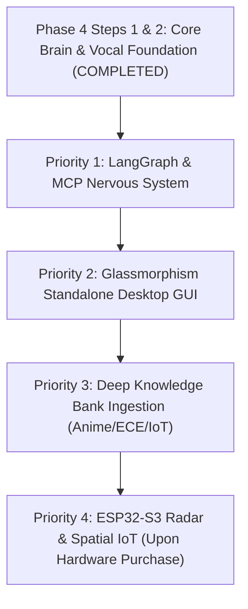

# JARVIS Anatomical Synthetic Intelligence Master Blueprint

This document defines the technical architecture of JARVIS mapped to human biology. Every anatomical organ system corresponds to a concrete, production-grade AI engineering subsystem.

---

## 🧬 Anatomical System Architecture

### 1. Prefrontal Cortex & Central Brain (Executive Control & Deep Reasoning)
- **Biological Analogy:** The seat of conscious thought, decision-making, and intent evaluation.
- **Technical Implementation:**
  - **Primary Model:** Ollama-hosted `llama3.1:latest` (8B parameters) running 100% in GPU VRAM (4.5GB footprint, `num_ctx=2048`).
  - **Dual-Process Cognitive Architecture:**
    - *System 1 (Fast Heuristic Route):* Direct streaming LLM generation bypassing tool-binding on conversational queries (< 1.5s first-token latency).
    - *System 2 (Deep Reasoning & Tool Binding):* Dynamic intent routing triggering tool schemas (`control_room`, `search_web`, `manage_workspace`) only when room hardware or external actions are requested.
  - **Safety & Alignment Override:** Custom system prompt enforcing unconstrained personality, direct answers, and concise 1–3 sentence responses.

---

### 2. Subcortical Memory Ganglia (Hippocampus & Amygdala)
- **Biological Analogy:** Long-term memory formation, episodic retrieval, and emotional context retention.
- **Technical Implementation:**
  - **Episodic Memory Bank:** Powered by `yaadash_core` (Mem0 + ChromaDB vector store).
  - **Asynchronous Hybrid Threading:** Memory extraction (`store_interaction`) runs in a background daemon thread (`threading.Thread`) *after* response delivery, preventing GPU VRAM thrashing and zeroing out interaction latency.
  - **Semantic Context Injection:** Relevant user preferences, historical project facts, and relationship guidelines are retrieved and prepended to system context dynamically.

---

### 3. Thalamus & Spinal Cord (The MCP Nervous System) — 🎯 PRIORITY 1 (IMMEDIATE NEXT STEP)
- **Biological Analogy:** The central nerve pathway relaying signals between the brain, sensory organs, and motor effectors.
- **Technical Implementation:**
  - **LangGraph State Graph:** Multi-agent cyclic state machine governing turn management, error recovery loops, and tool execution retry pipelines.
  - **Model Context Protocol (MCP) Bus:** Stateful connection multiplexer linking:
    - *Workspace MCP:* Local filesystem, Gmail, and Google Calendar.
    - *YouTube & Web MCP:* Browser automation and content ingestion.
    - *Obsidian Life Logger:* Real-time chronological journal logger.

---

### 4. Vocal Cords & Auditory Cortex (Perceptual & Acoustic Organs)
- **Biological Analogy:** Hearing, voice activity processing, speech generation, and vocal feedback.
- **Technical Implementation:**
  - **Ears (STT & VAD):** CPU-offloaded `faster-whisper` (`small`, `compute_type="int8"`), running zero VRAM footprint on CPU. Silero Voice Activity Detection (VAD) with 4-channel to 1-channel downmixing for Intel Smart Sound arrays.
  - **Vocal Cords (TTS Engine):** `edge-tts` with **`en-IN-NeerjaNeural`** voice—providing articulate, natural English while natively pronouncing Hindi & Hinglish terms (*Bhai*, *Haanji*, *Kaam*) flawlessly without turning them into garbled text.
  - **Speech Delivery Queue:** Threaded sequential speech queue (`speech_queue`) preventing sentence truncation and eliminating word-eating bugs.
  - **Interruption Memory Continuation Buffer:** If user speech interrupts JARVIS mid-sentence, un-spoken text is captured into `last_interrupted_script`. Saying *"continue"*, *"pick up"*, or *"what were you saying?"* resumes speech seamlessly (*"Right, as I was saying..."*).
  - **Audible State Cues & Siri-Style Hum:**
    - Verbal cues (`"Thinking..."`) and visual tracking (`You said: <text>`).
    - Soothing 432Hz/864Hz Siri-style harmonic resonance chime loop playing during transcription and thinking.

---

### 5. Ocular Organs & Visual Cortex (Vision & Perception)
- **Biological Analogy:** Real-time visual perception, screen analysis, and spatial vision.
- **Technical Implementation:**
  - **Vision Transformer:** Interfaced with lightweight vision models (Qwen2-VL / Moondream2).
  - **DOM & Visual Perception:** `chrome-devtools-mcp` for real-time web application UI inspection, visual artifact auditing, and screenshot validation.

---

### 6. Motor Cortex & Effector Hands (Software & Code Generation)
- **Biological Analogy:** Motor skills, fine movement, and tool usage.
- **Technical Implementation:**
  - **Vibe-Coding Software Factory:** Autonomous code iteration engine with local CLI access, Git control, and live testing harness.
  - **MicroVM Security Sandbox:** Firecracker / gVisor isolated containers for executing cyber-security tools (Nmap, Metasploit, Nuclei) safely.

---

### 7. Digestive System & Metabolic Knowledge Ingestion
- **Biological Analogy:** Ingesting raw fuel and converting it into wisdom and strength.
- **Technical Implementation:**
  - **Knowledge Extraction Pipelines:** Scrapers and parsers ingesting:
    1. Anime transcripts, movies, and literature SRT/text files.
    2. ECE (Electronics & Communication Engineering), Embedded Systems, C/C++, Robotics, and IoT textbooks.
  - Vectorized into ChromaDB/GraphRAG for instant semantic query.

---

### 8. Skeleton, Dermal Shell & Exoskeleton (Desktop GUI App)
- **Biological Analogy:** Physical structure, skin, and interactive interface.
- **Technical Implementation:**
  - **Desktop Application:** Standalone Tauri/React glassmorphism UI replacing PowerShell terminal.
  - **UI Features:** Real-time WebGL 3D audio visualizer orb, hardware control toggles (Lights, Fan), and status telemetry.

---

### 9. Peripheral Proprioception & Spatial Radar (Sensing & Touch)
- **Biological Analogy:** Physical presence sensing, touch, and spatial movement.
- **Technical Implementation:**
  - ESP32-S3 + `HLK-LD2410` 24GHz FMCW Radar presence sensing over MQTT.
  - *Status:* On hold until physical hardware is acquired by user.

---

## 🎯 Phased Priority Order Roadmap

1. **Priority 1 (IMMEDIATE NEXT STEP):** Build **The LangGraph & MCP Nervous System** (Spinal Cord).
2. **Priority 2:** Build **The Standalone Glassmorphism Desktop App** (Skeleton & Shell).
3. **Priority 3:** Ingest **Anime, Books, and Engineering Knowledge** into `yaadash_core` (Digestive System).
4. **Priority 4:** Integrate **ESP32-S3 Radar Hardware** (Peripheral Proprioception — Queued for hardware purchase).

---

## Next Action
We are ready to begin **Priority 1: The LangGraph & MCP Nervous System**.

> [!IMPORTANT]
> Please review this updated anatomical master blueprint and give the go-ahead to start building the LangGraph Nervous System!
