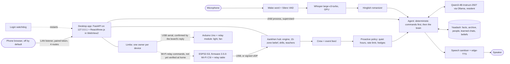

# JARVIS

A local-first personal assistant that runs on one laptop with a **6 GB GPU** and no
cloud LLM. It listens (Hinglish in, British English out unless asked otherwise),
remembers, switches the room's real light and fan, and senses the room through Wi-Fi
instead of a camera. It is built to say *"I don't know"* or *"unsure"* rather than
invent an answer.

> Subsystems carry Hindi names: **Yaadash** (याददाश्त, memory), **Aankhen** (आँखें,
> eyes) and **Limbs** (the relays).

This page is the honest overview, updated 2026-10-25. Every number is measured on the
target hardware unless it says otherwise; the method behind each one is in
[`docs/DECISIONS.md`](docs/DECISIONS.md) or the dated note in
[`docs/research/`](docs/research/README.md).

---

## What works today

| Area | What it does | Measured |
|---|---|---|
| **Brain** | Qwen3-4B-Instruct-2507 (Q4_K_M) through Ollama, kept resident at an 8192-token context | first token **0.85-0.93 s** warm, 10.2 s cold (was 22-97 s on the hybrid-reasoning Qwen3-4B) |
| **GPU budget** | Whisper turbo + Silero + the brain, both resident | **4.35-4.47 of 6 GB** |
| **Speech-to-text** | Whisper large-v3-turbo on the GPU, then single-script Hinglish | 15 s Hinglish clip in **2.7 s**, word-accurate (was 10.7 s, garbled) |
| **Voice turn** | end of my speech to his voice starting, 49 real spoken replies (week to 10-13) | median **4.12 s**, p90 8.09 s: still the weakest number |
| **Memory: facts** | every confirmed fact in the system prompt, every turn | live audit, 33 questions x 6 seeds: **193/198 correct**; 12/12 abstain when no fact exists |
| **Memory: people** | tie-strength model over a message archive | **95 % precision@20** against a hand-made list of closest people |
| **Memory: chats** | conversations with JARVIS become memories (facts, corrections, preferences), "remember that." works | chat probes **0/7 to 5/7**; off-topic leaks 0/8; ≤ 250 tokens a turn |
| **Light and fan** | an Arduino Uno relay board on USB switches the real loads; a switch counts only when the board's JSON reply confirms it | working since **2026-10-14**; no level or speed is ever claimed (relays only switch) |
| **Always on** | brain kept loaded, voice core supervised and restarted with backoff, login watchdog, microphone watchdog, one health line a minute | private memory **5427 to 3882 MB** (-28 %) after the fix |
| **Phone** | the laptop serves a remote page on the home Wi-Fi, **off by default**, QR pairing, hashed per-device tokens, instant revoke | light toggle **6.1 ms** median through the phone listener; page 21.8 KB |
| **Aankhen: it sees a person** | ESP32-S3 Wi-Fi CSI on the real board, human-band (0.4-4 Hz) motion energy | first light 2026-10-12: still 1.1x noise, typing 6x, walking 9x, moving 31x |
| **Aankhen: honest output** | confidence floors, out-of-range guard, empty-room reference per firmware and fan state, "waving" removed | replay of an unseen session: wrong answers shown **61.4 % to 50.0 %**, "waving" 68.6 % to 0 % |

---

## Experimental: built and tested, not yet proven at home

- **ESP32-S3 firmware 3.5.0.** CSI frames and relay commands over a signed UDP link
  beside USB (HMAC-SHA256, replay counters, a 5-relay table, mDNS). Flashed to the
  board on 2026-10-23; **the Wi-Fi link has not been verified at home yet**. On a
  loopback fake board: relay confirmed in 0.3 ms median, 500 Hz CSI in 63 datagrams
  a second with 0 lost. Until it is verified, the Uno on USB is the relay path.
- **Aankhen's zones and belief.** 15 zones in the room frame with a semi-Markov belief
  over them, drawn in the 3D twin as a dot cloud (dots in proportion to P(zone),
  opacity = confidence), not as a person.
- **Aankhen's data pipeline.** A 26-minute randomised drill runner with spoken prompts
  and per-block quality checks, free "teachers" (keyboard activity counts, phone on
  Wi-Fi, voice turns, relay changes; counts only), and a leave-one-day-out evaluator
  with PASS/FAIL gates (in-room ≥ 95 % on every held-out day, zone top-1 > 73 % by day
  7). **There is no multi-day labelled data yet**, so the gates have not been run on
  real days. The installed models were trained on about five minutes of one evening.
- **Proactive remarks.** The crew (movement watcher, chat learner, steward, task
  ledger) feeds events to JARVIS; a policy with quiet hours, a rate limit (one remark
  per 20 min) and mandatory hedges decides whether he speaks. Tested in scratch runs;
  a real night has not been measured.
- **Presence brings the room back.** Opening the Uno's port resets it, so after an app
  start the light and fan come back on once if I am there (keyboard within 120 s, or
  the real board at occupied p ≥ 0.8 for 20 s). Quiet hours and manual switches win.
- **Mission Germoney v2**, a study game inside the app: a skill tree as a real DAG
  (73 nodes, 0 loader errors), daily contracts generated from the tree that carry what
  to read first, steps and a "done when", an exam mode built on past-paper questions,
  an internship pipeline, a goal ladder from vision to week, gap re-entry after idle
  days, and a learning log. 14 screens became 5.
- **Away mode**: arms when the household's phones leave the Wi-Fi, then uses Aankhen's
  motion, the relay light and JARVIS's voice. Built and tested in code; not proven at
  home.

## Not done

- **Multi-day Aankhen data.** Until the drills run on many days, zone and activity
  answers stay mostly "unsure". Across two sessions on different firmware the models
  fell to 35-56 %; one Wi-Fi link sees *that* a body moved, not how it is bent.
- **The ESP32's Wi-Fi relay path at home** (above).
- **A real overnight run** of the always-on stack: false wakes, remarks and the memory
  trend from its own logs.
- **Voice latency.** About 4 s to the first spoken word is too slow.
- **Archive recall.** On 10 real questions the right message reached the model 3 times;
  most misses are at the relevance gate, not the ranking.
- **Belief distillation** from my own messages is implemented and has not been run on
  the full history. Learned chat memories have no review screen yet.
- **Fine-tuning.** Personality grows in context only. A QLoRA fine-tune of the 4B
  needs 300+ curated good exchanges first; there is 1.
- **No camera, ever, and no radar.** Aankhen is signals only. An LD2450 radar decoder
  is in the code from the early design; no radar was bought and none is planned.
- Known limitation: on long answers about the past, the 4B model sometimes narrates in
  the first person. A larger model would fix it; 6 GB does not fit one beside Whisper.

---

## Architecture



**Why it is split this way.**
- The voice core is a separate process: it owns the microphone, Whisper on CUDA and
  audio playback. If it crashes the window must not, and "put to sleep" must really
  free the GPU, which only a process exit guarantees.
- Room and game commands are parsed with regular expressions, not the model, so "fan
  band karo" is instant and can never be misheard into a different action. Questions
  go to the model with the live state in its prompt.
- **Nothing is claimed that a tool or a board did not confirm**, in the UI, in his
  speech or in these docs. Simulated data is tagged and never shown as measured.

**VRAM (6 GB):** brain ~3.1 GB at an 8192 context, Whisper + VAD + CUDA context ~1.1 GB.
Embeddings, BM25 and all of Aankhen's machine learning run on the CPU, by design.

---

## Subsystems

### Brain and voice: `core/`
`agent.py` (the brain, two temperatures: lively for chat, near-deterministic for answers
grounded in memory), `jarvis.py` (wake word, VAD end-pointing, Whisper, TTS),
`hinglish.py` (Devanagari runs romanized, English untouched so commands still match),
`proactive.py` (when he may speak unasked), `mic.py` (the microphone pinned by name and
reopened when it stalls), `ollama_guard.py` (keeps the brain loaded at the right context).

### Memory: `yaadash/`
Confirmed facts in every prompt (LanceDB + bge-small on CPU); a 110k-message archive
as 14k embedded conversation windows with BM25 + vector search and Reciprocal Rank
Fusion; a people model; a taste model; beliefs with confidence; and since 10-14 a chat
learner (`learn_chats.py`, `chat_memory.py`) that turns conversations with JARVIS into
memories that can be superseded or retracted. Design:
[`docs/research/memory-feasibility.md`](docs/research/memory-feasibility.md),
[`2026-10-14-yaadash-feedback-loop.md`](docs/research/2026-10-14-yaadash-feedback-loop.md).

### Sensing: `aankhen/`
The ESP32-S3 measures how a body disturbs the Wi-Fi channel state information (CSI)
between it and the router (firmware in `aankhen/firmware/`). The host conditions the
CSI, undoes the radio's automatic gain, averages away the ceiling fan's aliasing,
detects human-band motion, and keeps a rolling week of raw CSI for training. Every
frame is tagged `hardware`, `replay` or `simulation`. Capabilities one antenna cannot
physically deliver (pose, heart rate) are disabled, not faked. Physics and learning:
[`docs/design/aankhen-physics.md`](docs/design/aankhen-physics.md),
[`docs/design/aankhen-learning.md`](docs/design/aankhen-learning.md); the drill:
[`docs/aankhen-drill-guide.md`](docs/aankhen-drill-guide.md).

### Relays: `limbs/` and `app/jarvis_app/limbs.py`
`limbs/uno_relay/uno_relay.ino` is the Uno firmware; `uno.py` owns its serial port;
`limbs.py` is the single writer for every device, reads `devices.json` (which board
owns which load), and on reconnect **adopts the board's state** instead of pushing a
stale one. Modes are editable on/off sets, usable by voice.

### App: `app/`
FastAPI backend on 127.0.0.1 with a per-launch token, and a React/three.js UI in a
native WebView2 window: Core, Yaadash, Aankhen (the 3D twin), Limbs, Connect (every
sensor and model, checked live), System (VRAM, models, logs) and Mission. Details:
[`app/README.md`](app/README.md).

---

## Hardware

- Laptop: Windows 11, NVIDIA RTX 4050 (6 GB), 16 GB RAM.
- ESP32-S3 dev board (Aankhen) on USB; firmware 3.5.0 lets it run on its own 5 V phone
  charger with no cable to the laptop.
- Arduino Uno with an HL-52S relay module (active-low), contacts wired in parallel with
  the wall switches of one light and one ceiling fan.

## Mains safety

The relay side switches **230 V AC**. That can kill, and it can start fires.

- Have a qualified electrician do or check the mains wiring. Work only with the circuit
  off at the breaker, and prove it dead with a tester first.
- Keep every mains terminal inside a closed, non-conductive box with strain relief.
  The low-voltage side (USB, the boards) never shares a terminal with mains. Power the
  ESP32 from an unmodified, certified 5 V charger; never build a mains-to-5 V supply.
- Check the rating printed on each relay and stay well below it. Only a light and a
  fan are on relays here; high-current loads (an AC, a water heater) never go on one.
- The relay is in **parallel** with the wall switch: with the wall switch ON the load is
  on whatever JARVIS says, and he cannot know. Treat the wall switch as the master.
- In software: relays boot OFF; a switch counts only when the board confirms it; on
  reconnect the app adopts the board's state, so a power cut can never be followed by a
  stale "light on" at 3 am; restarting the app resets the Uno and turns both loads off;
  ESP32 relay pins are checked against a list of safe GPIOs.
- On the network: Wi-Fi relay commands are signed (HMAC-SHA256) and replay-checked, but
  **not encrypted**, so anyone on the home Wi-Fi can read the CSI and the relay states.
  The firmware's HTTP relay route needs a token, and MQTT switching needs a broker login.

## Privacy

- All personal data stays on the machine in `data/`: memory stores, transcripts, the
  home's layout and zones, sensor recordings, trained models and app state. The whole
  folder is git-ignored, as is `aankhen/firmware/secrets.h`.
- No cloud LLM; the brain, Whisper and the embedder run locally. Text-to-speech uses
  Microsoft's online neural voices (edge-TTS), which receive the reply text; offline it
  falls back to Kokoro-82M on the laptop.
- No camera. The free teachers log *that* input happened, never which key, no text and
  no audio.
- The phone listener is off by default, binds only to private addresses, and serves four
  routes: the memory archive, Mission and settings never reach the network.
- Identity documents are never ingested, and JARVIS is tested to refuse to recite them.

---

## Running it

**Requirements:** Windows 11, an NVIDIA GPU with 6 GB+ VRAM, Python 3.11, Node.js (for
building the UI), [Ollama](https://ollama.com).

```bash
python -m venv .venv
.venv/Scripts/python.exe -m pip install -r requirements/requirements.gpu.txt -c requirements/constraints.gpu.txt
.venv/Scripts/python.exe requirements/link_venv.py
ollama pull qwen3:4b-instruct-2507-q4_K_M
cd app/ui && npm ci && npm run build && cd ../..
.venv/Scripts/pythonw.exe app/JARVIS.pyw
```

`requirements.gpu.txt` lists exactly what the code imports (a test fails if it drifts);
`constraints.gpu.txt` pins the rest, and torch comes from PyTorch's CUDA 12.1 index.
`link_venv.py` puts `core/`, `yaadash/` and the root on the venv's path. The app starts
the voice core from its Core tab; say **"Jarvis"**, then speak.

- **Start at login (opt-in):** `.venv/Scripts/python.exe app/install_startup.py` puts a
  shortcut to the watchdog in the Startup folder (`--remove` undoes it, `--dry-run`
  shows it). No registry, no admin.
- **Boards:** the ESP32-S3 is the sensor and, since 2026-10-28, the relay board (six relays in the wall box; `docs/aankhen-esp32-relays.md`). Copy `aankhen/firmware/secrets.example.h` to `secrets.h`. Compile and
  flash from the app (Limbs, Firmware) or with arduino-cli. The Uno sketch is
  `limbs/uno_relay/uno_relay.ino`. Close the app before flashing: it holds the ports.
- **Memory from your own data export:** `.venv/Scripts/python.exe yaadash/refresh_memory.py`.

**Tests** (against scratch data folders, never the real `data/`):

```bash
.venv/Scripts/python.exe -m pytest aankhen/tests crew/tests core/tests
.venv/Scripts/python.exe -m pytest yaadash/tests
.venv/Scripts/python.exe -m pytest requirements
cd app && JARVIS_DATA_DIR=../scratch ../.venv/Scripts/python.exe -m pytest tests
cd app/ui && npx vitest run && npx tsc -b
```

---

## Engineering notes worth reading

Problems where the obvious approach was wrong, each written up with its evidence:

- **The model wasn't the bug; the context was.** Wrong answers traced to retrieval
  handing the model a placeholder, a truncated fact and an unrelated message.
- **Row count is not progress.** 12,799 short chat fragments (median 27 characters) made
  retrieval *worse*. Measured the distribution, filtered, fixed.
- **A ceiling fan in the human band.** Its blades flicker the channel at ~23 Hz; sampled
  at 100 Hz its fourth harmonic folded to a 7.7 Hz line that read as movement. Faster pings plus averaging every packet
  in a 10 ms slot put the filter's nulls on the folding frequencies.
- **An empty room that wasn't.** The first real calibration had someone elsewhere in the
  home moving near the router 57 % of the time, which set the threshold at 35x noise and
  hid a person at the desk. Calibration now keeps only quiet windows.
- **Opening a serial port can switch mains.** Opening the Uno's port pulses its reset
  line and drops both relays, so exactly one process owns it and nothing else probes it.
- **A 15.6 ms clock.** Relay confirmations took 203 ms because `time.monotonic()` ticks
  every 15.6 ms on Windows Python; with `perf_counter` they take 0.3 ms.
- **Abstention can't be one threshold.** Real and forced recall matches overlap in
  embedding distance (0.304 vs 0.307), so a numeric gate removes clear misses and the
  model judges the ambiguous band.

---

## Repository layout

```
app/          desktop app: FastAPI server (jarvis_app/), React UI (ui/), watchdog, startup
core/         JARVIS himself: voice loop, agent, mic, proactive policy, room and mission parsers
crew/         always-on agents (movement, learner, steward, ledger) and the event feed
yaadash/      memory: facts, archive, people, recall, taste, beliefs, chat learner
aankhen/      Wi-Fi sensing: transport, Wi-Fi link, engine, zones, belief, drill, evaluator
  firmware/     ESP32-S3 sketch (copy secrets.example.h to secrets.h)
limbs/        Uno relay firmware
mission-germoney/  the original Expo app (the game now lives in app/)
docs/         DECISIONS.md (engineering log), ROADMAP.md, TESTING.md, research/, design/
requirements/ what the code imports, pinned (Python 3.11), and the check that keeps it so
data/         everything personal: git-ignored, never pushed
```

First-generation code sits in `legacy/` folders: kept for reference, never imported.
